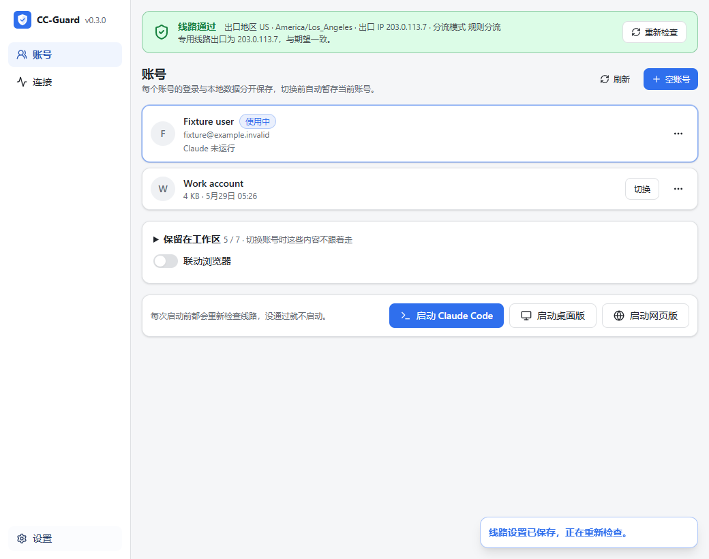
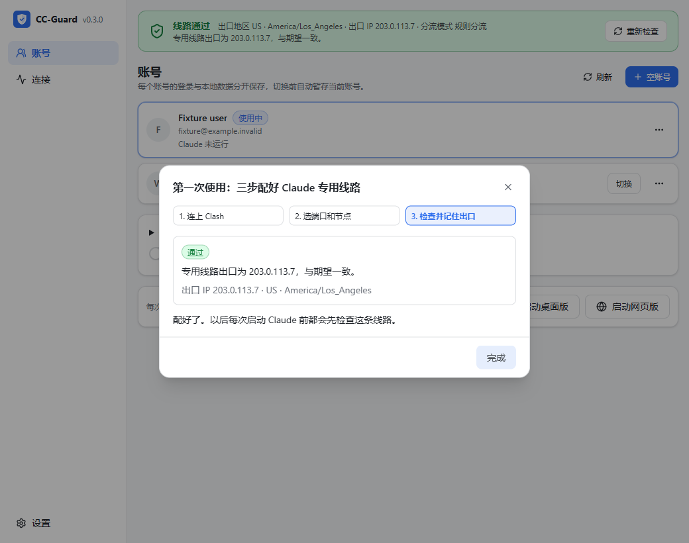
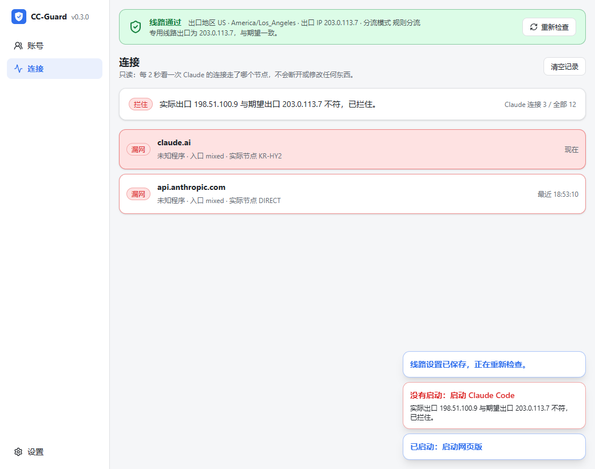

# CC-Guard

**让 Claude 只走你在 Clash 里指定的那条线路，多个账号一键切换、互不串号。**

Windows 桌面应用，给已经在用 [Clash Verge Rev](https://github.com/clash-verge-rev/clash-verge-rev)（mihomo 内核）的人用。CC-Guard 不搭代理、不改你的订阅，只做三件事：**检查**线路是不是真的通、**守住** Claude 的启动入口、**管理**多个 Claude 账号的本地数据。

[English](README.en.md) · [更新记录](CHANGELOG.md) · [参与开发](CONTRIBUTING.md) · [安全说明](SECURITY.md)



> 当前版本 v0.3.0，仍在开发中。只支持 Windows 10/11 x64。截图里的账号和 IP 都是测试用的虚构数据。

## 它能做什么

| 功能 | 说明 |
|---|---|
| 线路检查 | 经你的 Claude 专用端口，向多个独立的出口查询服务问「我现在是哪个 IP」。至少 2 个服务给出结果且彼此一致、并等于你记住的出口，才算通过。 |
| 启动门禁 | 启动 Claude Code、桌面版、网页版前都重新检查一次线路，没通过就不启动，并告诉你原因。 |
| 只给 Claude 换线路 | Claude Code 只在它自己的控制台里设专用端口代理；桌面版带 `--proxy-server` 参数启动。不改系统代理，不改你的环境变量。 |
| 连接核对 | 读取 Clash 的实时连接，Claude 的流量（按域名和进程名识别）只要没经过你指定的节点或代理组，就标红列出。 |
| 多账号 | 每个账号的登录状态和本地数据分开加密保存，切换前自动暂存当前账号，失败自动回滚。 |
| 首次向导 | 三步：连上 Clash → 选专用端口和节点 → 检查并记住出口。 |

它**不做**这些：不帮你搭代理或买节点、不伪造 IP 或位置、不保证服务端怎么看待你的账号。



## 开始前你需要

1. **Clash Verge Rev 正常运行**，并打开外部控制：设置 → Clash 设置 → 外部控制，地址填 `127.0.0.1:9097`，记下密钥。Clash Verge 默认只开命名管道，CC-Guard 需要这个 TCP 地址。
2. **一个只给 Claude 用的入口端口**，绑定到你想让 Claude 固定使用的节点或代理组。在 Clash Verge 的「全局扩展覆写配置（Merge）」里加入，把 `proxy` 换成你自己的节点或组名：

   ```yaml
   listeners:
     - name: claude-fixed-http
       type: http
       port: 17892
       listen: 127.0.0.1
       proxy: 你的Claude专用节点或组
   ```

   建议同时加规则，让没走专用端口的 Claude 流量（比如开了 TUN 时）也去同一个节点或组：

   ```yaml
   prepend-rules:
     - PROCESS-NAME,claude.exe,你的Claude专用节点或组
     - DOMAIN-SUFFIX,anthropic.com,你的Claude专用节点或组
     - DOMAIN-SUFFIX,claude.ai,你的Claude专用节点或组
     - DOMAIN-SUFFIX,claude.com,你的Claude专用节点或组
   ```

3. 已安装 Claude Code 和/或 Claude 桌面版（官方渠道）。

## 安装

暂未发布安装包，请从源码构建（见下面「开发」）。构建产物是 `CC-Guard_<版本>_x64-setup.exe`，装在当前用户目录下，不需要管理员权限。

请从开始菜单或资源管理器启动 CC-Guard，**不要从终端启动**：程序会继承终端的环境变量，再传给它启动的 Claude Code。

## 第一次使用

1. 打开后会弹出向导。填 Clash 控制地址和密钥 → 专用端口（如 `17892`）和节点（代理组排在最前面）→ 检查，看到出口 IP 后点「记住这个出口」。
2. 顶部状态条变绿就可以从底部按钮启动 Claude 了。
3. 「连接」页随时看 Claude 的流量有没有漏网。



## 工作原理

- **线路检查**：只读请求 mihomo 的 `/configs`；经专用端口依次请求 ifconfig.co、Cloudflare trace、ipwho.is。专用端口如果和 Clash 的普通入口（mixed-port 等）是同一个，直接判失败，因为那个端口跟着日常分流走。
- **连接核对**：只读请求 `/connections`。判断依据是这条连接的链路里有没有出现你指定的节点或组，所以组内自动切换成员（如 fallback）不会误报；实际出口 IP 仍由线路检查严格核对。
- **读不到、超时、格式不对，一律不算通过。** 只有「通过」显示绿色。

## 数据与隐私

- 设置和账号保险库都在 `%APPDATA%\io.github.shiqiyux-cmd.cc-guard`，文件只有你本人的 Windows 账户能访问。
- Clash 密钥只写不读，界面拿不到它；Claude 的登录凭据只在本机原生层处理，不送给界面、不上传。
- 应用没有遥测。会访问的外部地址只有上面三个出口查询服务（它们会看到你的出口 IP）。
- 详见 [SECURITY.md](SECURITY.md)。

## 已知限制

- 只看得到经过 Clash 的连接；没开 TUN 时，绕过代理的直连看不见。
- 结果只代表检查那一刻；托盘每 5 分钟复查一次。
- npm 安装的旧版 Claude Code 进程名是 `node.exe`，只能按域名识别。
- 网页版目前用内置的指纹浏览器，安装包约 130 MB；后续会改为系统 Edge/Chrome 的独立资料。
- 安装包没有代码签名，Windows SmartScreen 可能提示，请核对来源。

## 开发

需要：Rust（x64 MSVC 工具链）、Visual Studio C++ Build Tools、WebView2、[Bun](https://bun.sh)、Node.js 22+、Python 3.12+、PowerShell 7（`pwsh`）。

```powershell
bun install --frozen-lockfile
bun run tauri dev
```

打 Windows 安装包（会按固定 SHA-256 下载指纹浏览器引擎）：

```powershell
bun run build:windows
```

检查：

```powershell
bun test
bun run build
bun run test:ui
bun run test:identities
cargo test --manifest-path src-tauri/Cargo.toml
```

线路检查和连接核对另有用真实 mihomo 内核跑的离线判卷台，见 [CONTRIBUTING.md](CONTRIBUTING.md)。

## 致谢与许可

基于 [liseami/CCBaga](https://github.com/liseami/CCBaga)（MIT）的身份管理与浏览器代码改造而来。原创部分采用 [MIT](LICENSE) 许可；第三方组件见 [NOTICE.md](NOTICE.md)。

Claude、Anthropic 是 Anthropic 的商标；本项目与 Anthropic 无关，使用时请遵守 Claude 的服务条款和你所在地区的法律。
